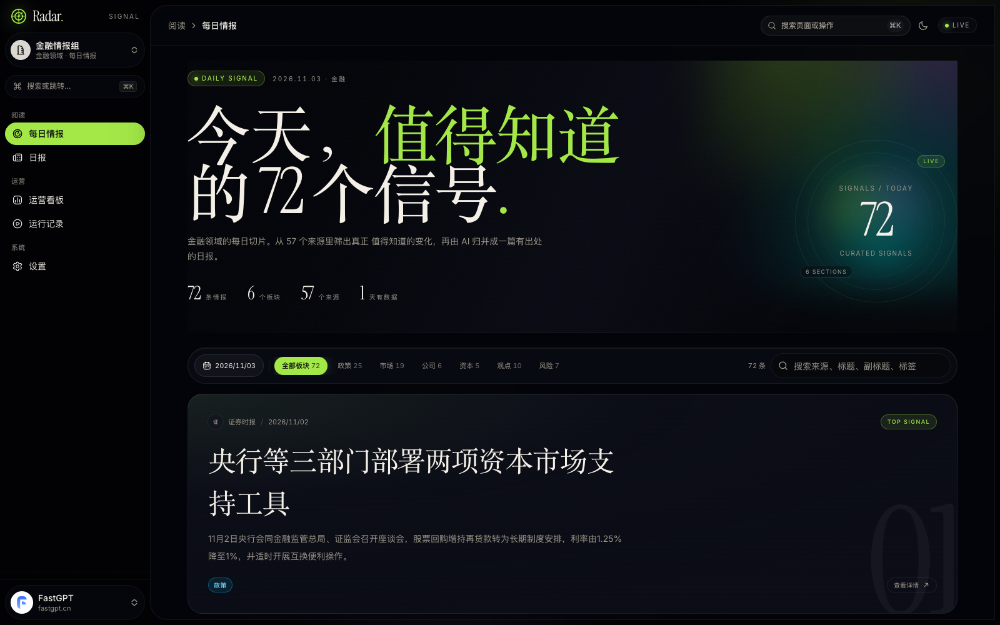
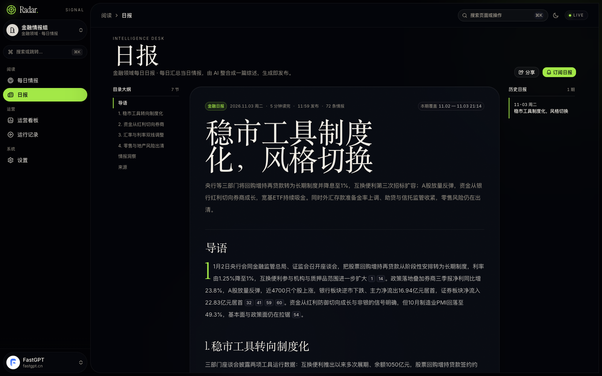
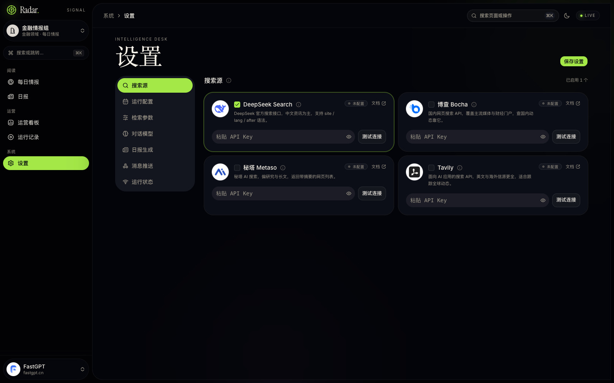

# 行业情报雷达 · Radar

> 每天把散落在各处的行业新闻，收成 72 条有出处的情报，再由 AI 写成一篇能读的日报。

一个跑在本地 SQLite 上的行业情报工作台：多源搜索 → 分类去重 → 生成日报 → 推送到企业微信 / 钉钉 / 飞书群。
支持多个**相互隔离的工作区**（金融、人工智能，或任何你自己输入的领域），每个工作区的检索词、提示词、Key、情报与日报完全独立。







## 它能做什么

- **每日情报**：卡片流，按日期与板块筛选，支持来源 / 标题 / 标签搜索。
- **AI 日报**：DeepSeek 原生接口把当天情报归并成「导语 + 3–4 个主题小节 + 情报洞察」，正文带 `[n]` 引用与来源悬停卡。
- **四个搜索源**：DeepSeek、博查、秘塔、Tavily，可多选并行检索，Key 分别保存、可单独测试连接。
- **多工作区**：新建时按领域生成一版通用模板（检索词 + 提示词），之后按自己的领域改；删除会连同数据一起清掉。
- **群机器人**：企业微信 / 钉钉 / 飞书 Webhook，推送日报正文 + 末尾相关新闻（标题、链接、发布日期）。
- **定时运行**：进程内调度（Asia/Shanghai），可配执行时间、运行日、错过补跑。
- **自带登录**：口令登录 + httpOnly 会话，全站与 API 统一守卫。

## 技术栈

Next.js 16（App Router）+ React 19 + Tailwind v4 + Base UI（shadcn `base-nova`）
SQLite（`node:sqlite`，WAL）+ 仓储层，Server Actions + Zod，DeepSeek `chat/completions`。

## 快速开始

```bash
pnpm install

cp .env.example .env.local
# 至少填两行：
#   APP_AUTH_PASSWORD=<你的访问口令>
#   DEEPSEEK_API_KEY=<你的 DeepSeek Key>

pnpm dev --port 4310
```

打开 http://localhost:4310 ，输入口令登录。首次启动会自动建表并写入两个演示工作区（金融 / AI）。

## 环境变量

| 变量 | 必填 | 说明 |
|---|---|---|
| `APP_AUTH_PASSWORD` | 生产必填 | 登录口令；不配时开发放行、生产除 `/api/health` 外一律 503 |
| `DEEPSEEK_API_KEY` | 建议 | 对话与 DeepSeek 搜索共用；也可只在设置页填 |
| `BOCHA_API_KEY` / `METASO_API_KEY` / `TAVILY_API_KEY` | 可选 | 其余搜索源的兜底 Key |
| `INGEST_TOKEN` | 可选 | 让脚本用 `x-ingest-token` 免登录调 `POST /api/intel/ingest` |
| `APP_BASE_URL` | 可选 | 推送消息里「查看完整日报」的站点地址 |
| `DATABASE_PATH` | 可选 | 默认 `.data/intel.sqlite`；容器里用 `/app/.data/intel.sqlite` |
| `INGEST_TIMEOUT_MS` / `INGEST_SEARCH_CONCURRENCY` | 可选 | 采集预算（默认 240s）/ 搜索并发（默认 8） |

`.env*` 与 `.data/` 都在 `.gitignore` 里，不会进仓库，也不会打进镜像。

## 数据与工作区

```
工作区（workspaces）
  ├─ items / briefs / runs
  ├─ app_settings（检索词、提示词、模型、定时）
  ├─ search_provider_keys（每个搜索源的 Key）
  └─ webhook_endpoints（企业微信 / 钉钉 / 飞书）
```

所有表都带 `workspace_id`，切换器写入 `intel_workspace` cookie，服务端页面、Server Action 与 API 都按它读写，
所以工作区之间看不到彼此的数据。

## 部署

```bash
docker build --platform linux/amd64 -t intel-radar:latest .

docker run -d -p 3000:3000 \
  -e APP_AUTH_PASSWORD=<访问口令> \
  -e APP_BASE_URL=https://<你的域名> \
  -v /srv/intel-radar:/app/.data \
  intel-radar:latest
```

- 必须把卷挂到 `/app/.data`，否则重启即丢数据；
- 单副本（`replicas: 1`）：调度器与 SQLite 连接都在进程内；
- Sealos 的完整步骤见 [docs/deployment-sealos.md](docs/deployment-sealos.md)。

## 目录

```
src/app/(app)/        today / briefs / admin / runs / settings
src/app/login/        口令登录页
src/lib/server/       搜索、DeepSeek、采集、调度、Webhook、SQLite
src/components/intel/ 领域组件（daily / briefs / admin / runs / settings）
docs/                 部署说明、后端说明、PRD、界面截图
```

## 说明

- 演示公司名为虚构，媒体名为真实站点；`docs/screenshots/` 是界面验收截图。
- 采集需要联网并消耗搜索源与模型的额度。
- 目前没有开源许可证文件，默认保留所有权利；如果你需要 MIT 之类的许可，请自行添加。
